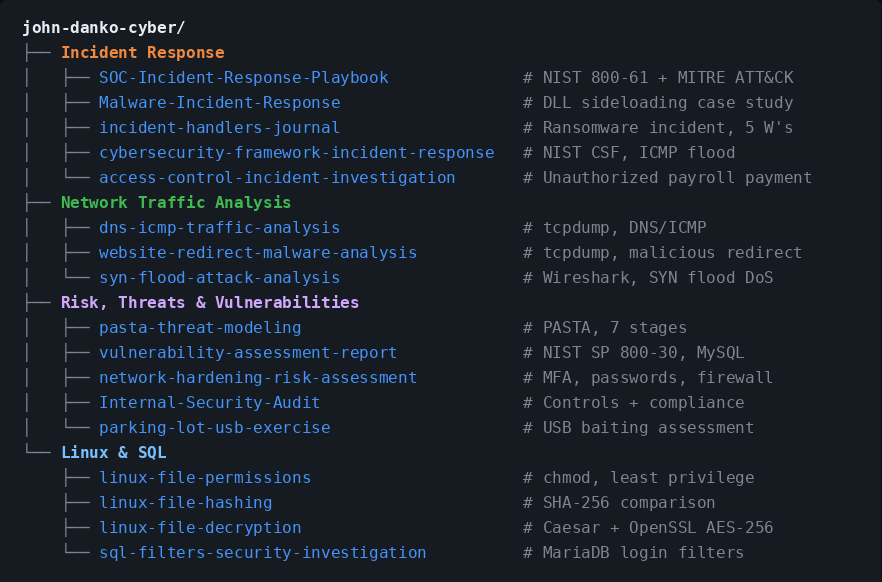

# John Danko

Cybersecurity graduate based in Greater Philadelphia pursuing an SOC Analyst role, with hands-on practice in SIEM, log analysis, network traffic analysis, and incident response.

- B.S. in Computer Information Science, Cybersecurity Specialization, Gwynedd Mercy University (Cum Laude, Fall 2024)
- Competed in the DoD Cyber Sentinel Skills Challenge (Correlation One, June 2025) in forensics, malware and reverse engineering, networking and recon, OSINT, and web security
- Wrote a malware incident response case study, SOC playbooks for five alert types, and incident reports from provided tcpdump and Wireshark logs
- Building hands-on skills in Splunk and Google Security Operations through SOC labs

**Tools:** Splunk, Google Security Operations, Microsoft Defender, Wireshark, tcpdump, Nmap, Nessus, Metasploit, Burp Suite, FTK Imager, Autopsy, John the Ripper, pfSense  
**Frameworks:** NIST SP 800-61, NIST CSF, MITRE ATT&CK, Cyber Kill Chain  
**Languages:** Python, Bash, C++, Java, SQL, HTML, JSON

## 🗂️ Project Tree

<b>Click to open project links</b>

<pre>
<b>john-danko-cyber/</b>
├── <b>Incident Response</b>
│   ├── <a href="https://github.com/john-danko-cyber/SOC-Incident-Response-Playbook">SOC-Incident-Response-Playbook</a>              # NIST 800-61 + MITRE ATT&amp;CK playbooks
│   ├── <a href="https://github.com/john-danko-cyber/Malware-Incident-Response">Malware-Incident-Response</a>                   # DLL sideloading case study
│   ├── <a href="https://github.com/john-danko-cyber/incident-handlers-journal">incident-handlers-journal</a>                   # Ransomware incident, 5 W's
│   ├── <a href="https://github.com/john-danko-cyber/cybersecurity-framework-incident-response">cybersecurity-framework-incident-response</a>   # NIST CSF, ICMP flood
│   └── <a href="https://github.com/john-danko-cyber/access-control-incident-investigation">access-control-incident-investigation</a>       # Unauthorized payroll payment
├── <b>Network Traffic Analysis</b>
│   ├── <a href="https://github.com/john-danko-cyber/dns-icmp-traffic-analysis">dns-icmp-traffic-analysis</a>                   # tcpdump, DNS/ICMP
│   ├── <a href="https://github.com/john-danko-cyber/website-redirect-malware-analysis">website-redirect-malware-analysis</a>           # tcpdump, malicious redirect
│   └── <a href="https://github.com/john-danko-cyber/syn-flood-attack-analysis">syn-flood-attack-analysis</a>                   # Wireshark, SYN flood DoS
├── <b>Risk, Threats &amp; Vulnerabilities</b>
│   ├── <a href="https://github.com/john-danko-cyber/pasta-threat-modeling">pasta-threat-modeling</a>                       # PASTA, 7 stages
│   ├── <a href="https://github.com/john-danko-cyber/vulnerability-assessment-report">vulnerability-assessment-report</a>             # NIST SP 800-30, MySQL
│   ├── <a href="https://github.com/john-danko-cyber/network-hardening-risk-assessment">network-hardening-risk-assessment</a>           # MFA, passwords, firewall
│   ├── <a href="https://github.com/john-danko-cyber/Internal-Security-Audit">Internal-Security-Audit</a>                     # Controls + compliance
│   └── <a href="https://github.com/john-danko-cyber/parking-lot-usb-exercise">parking-lot-usb-exercise</a>                    # USB baiting assessment
└── <b>Linux &amp; SQL</b>
    ├── <a href="https://github.com/john-danko-cyber/linux-file-permissions">linux-file-permissions</a>                      # chmod, least privilege
    ├── <a href="https://github.com/john-danko-cyber/linux-file-hashing">linux-file-hashing</a>                          # SHA-256 comparison
    ├── <a href="https://github.com/john-danko-cyber/linux-file-decryption">linux-file-decryption</a>                       # Caesar + OpenSSL AES-256
    └── <a href="https://github.com/john-danko-cyber/sql-filters-security-investigation">sql-filters-security-investigation</a>          # MariaDB login filters
</pre>

📫 [LinkedIn](https://www.linkedin.com/in/john-danko-cyber) | [Portfolio Website](https://john-danko.netlify.app) | [Download Resume](https://github.com/john-danko-cyber/john-danko-cyber/raw/main/John_Danko_Resume.pdf)
